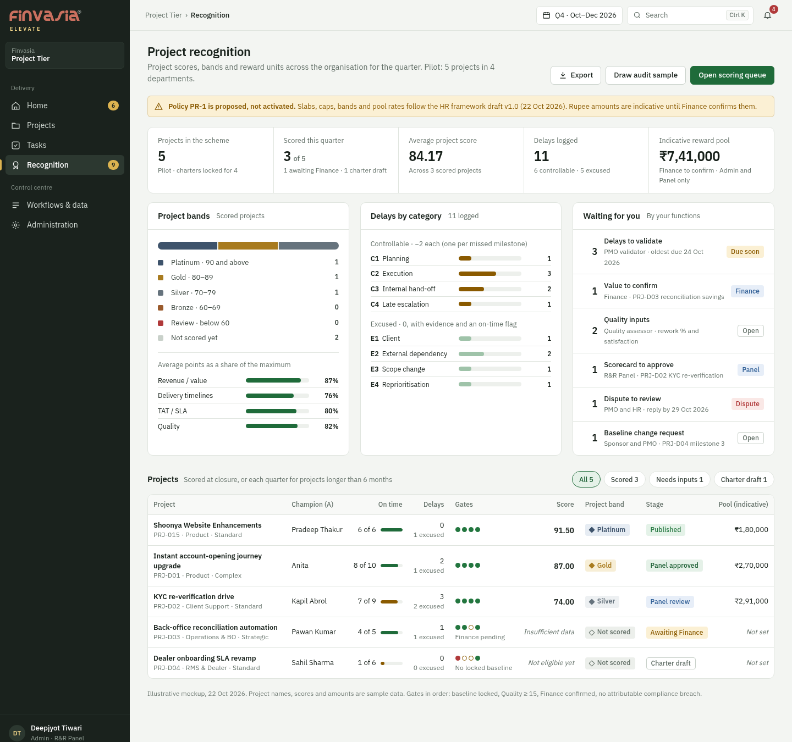
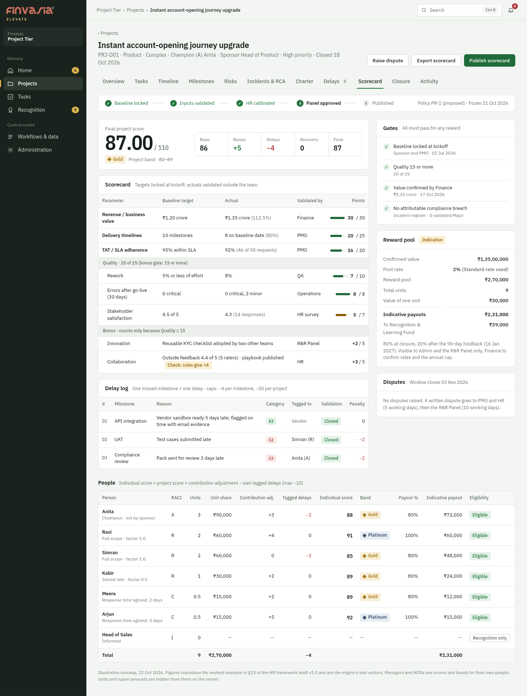

# Project Tier: Project R&R Framework implementation plan (org level)

Drafted 22 Oct 2026. Status: **built locally on 28 Oct 2026 from the Project Tier prototype, not deployed; see `CLAUDE.md` §22.** Where this plan says milestones, the build uses tasks: one late task = one delay, and the delay reasons follow the 23 Oct list. Source: `Project Rewards & Recognition Framework.docx` (HR Strategy, Draft v1.0, 22 Oct 2026).

## Context

HR Strategy's **Project Rewards & Recognition Framework (Draft v1.0, 22 Oct 2026)** scores each project out of 100 (+10 bonus, −20 delay cap), splits a reward pool across people by RACI units, and adds delay rules, gates, eligibility, disputes and anti-gaming checks.

Today the Project Tier has only delivery features: projects, milestones, tasks with independent review, blockers, deadline changes, risks, incidents and RCA, 8-stage closure, cross-department requests and workflow templates with RACI by stage. It has no baseline, project RACI, delay log, SLA measure, value target or project score. This plan adds the framework **on top of** those records so nothing is typed twice. The Individual Tier stays as it is.

**Decisions taken (22 Oct 2026):**
- **Money:** compute RACI units and an *indicative* ₹ payout, labelled "proposed, Finance to confirm". Only Admin and R&R Panel members see it. There is no payout ledger, holdback ledger or fund ledger.
- **Bands:** use the doc's five bands (Platinum ≥90, Gold 80–89, Silver 70–79, Bronze 60–69, Review <60). The UI always calls them a "Project band", so they are never confused with Individual Tier tiers.
- **Validators:** Admin tags existing named accounts with *functions*: PMO validator, Finance confirmer, Quality assessor, HR calibrator and R&R Panel member. There are no new login roles.
- **Team penalty:** the doc's formula applies. Individual score = project score + contribution adjustment − that person's tagged delays. Only validated, controllable delays count. CLAUDE.md's "a late project must not penalise everyone" is replaced for this framework, and the change will be recorded there.

## Fit analysis: doc → what exists → what to build

| Doc element | Exists today | Action |
|---|---|---|
| Charter, locked baseline (value target, milestone dates, SLAs, RACI) | `Project`, `Milestone.target_date`, template RACI by stage | **New** `ProjectCharter` plus `Milestone.baseline_date`. Lock needs the sponsor and PMO, never the champion alone. |
| Project RACI (1 A, R × contribution factor, C with agreed response time, I) | `ProjectMember.role` (free text); `TemplateStage` R/A/C/I | **New** `ProjectRaci` rows, effective-dated for pro-rating. Prefilled from template stages and task assignments. |
| Baseline change request (sponsor + PMO) | `DeadlineChange` (task level) | **New** `BaselineChange`. Once approved it becomes an E3 excuse and resets dates, and the original is kept. |
| Delay log (one per missed milestone, C1–C4 / E1–E4, evidence, validation 2/3/5 working days, challenge) | `Blocker` (excludable categories), `add_business_days` | **New** `ProjectDelay`. Blocker categories suggest the E-code. C4 is derived when the first flag came less than 2 business days before the due date. With no evidence after 5 working days, the delay becomes controllable automatically. |
| Delivery timelines (milestones on baseline date) | Milestone state, accepted submission dates on tasks | Add `Milestone.delivered_on` = the latest accepted submission date of its linked tasks, so reviewer waiting never counts. Excused delays count as on time. |
| TAT/SLA adherence | Template stage SLA (business days), `WorkRequest` dates | **New** `ProjectSla` list, fixed at lock. Measured automatically from template-stage tasks (start → accepted submission, in business days), plus manual counts for client SLAs (Draft → Submitted → Validated). |
| Quality: rework, post-go-live errors, satisfaction | `ReviewDecision` rework (requirement-change rework excluded), `Incident.severity_validated` | A Quality assessor enters rework % (the system suggests a value from reviews) and satisfaction. Errors are counted from validated incidents in the 30 days after `go_live_date` (Major = critical, Minor/Medium = minor, *proposed*). |
| Revenue / value (incl. non-revenue value targets) | — | The champion enters the actual and a Finance-tagged account confirms it. Until then the score shows "Awaiting Finance" and the gate fails. |
| Bonus: innovation (Panel), collaboration (≥3 outside raters, +1 for help or a playbook) | — | **New** `ProjectFeedback` (the rater must not be in the project RACI; only the average is shown, and only once there are 3 raters) and a Panel innovation award of 0–5. The bonus counts only if Quality ≥ 15. |
| Gates (compliance breach, Quality < 15, no Finance confirmation, baseline not locked) | `Incident` attribution and severity validation | Derived. A validated Major incident attributed to the project fails the compliance gate. |
| Scores, caps, recovery credit, bands, units, payout | `services/scoring.py` (pure-engine pattern) | **New pure** `services/project_scoring.py` |
| Contribution adjustment −10..+10 (set by A; the sponsor sets A's), HR calibration | — | Fields on the scorecard's person rows, with an audit entry for each change |
| Scoring at closure, or by quarterly phase for projects over 6 months; frozen; R&R Panel approval | `ProjectClosure`, `Snapshot` pattern | **New** `ProjectScorecard` + `ProjectScorecardPerson`: Draft → Calibrated (HR) → Approved (Panel, no one from the project's RACI) → Published. Frozen on approval. |
| Disputes (7 working days to raise, 5 for PMO/HR review, 10 for the Panel) | `CorrectionRequest` pattern (Individual Tier) | **New** `ProjectDispute`. An upheld dispute re-freezes the scorecard and keeps the old and new results. |
| Eligibility (≥30 days or 25% of the duration, good standing, employed on the payout date, probation) | Employee record, RACI dates | Derived where data exists. Disciplinary and probation status have no source yet, so they show as "Unknown" (never "pass"). |
| Anti-gaming: benchmark (>25% easier), 10% quarterly audit sample | Closed projects, template | Benchmark flag when there are ≥3 comparable closed projects, otherwise "Not enough history". A seeded random 10% sample for HR and Finance, with outcomes audited. |
| Monthly health snapshot (visibility only) | `project_metrics` health | Show band and score trend on the Portfolio. No new scoring. |
| Annual awards, team kicker, non-monetary recognition by band | Old `Nomination` model (tied to Period) | **Later phase** (P7). |

**Not built (by decision or from the doc):** pool funding records, the 80/20 holdback ledger, clawback, the Recognition Fund balance, the annual per-person cash cap (shown as a Finance input) and the KEKA or performance-system feed.

## Data model (new file `backend/app/models/project_rr.py`)

- `ProjectCharter`: project_id (unique), project_type (Standard | Complex | Strategic), sponsor_id, champion_id (A), value_kind (revenue | hours saved | cost avoided | adoption | risk), value_unit, value_target, value_actual, value_confirmed_by/at, go_live_date, scoring_mode (closure | quarterly), state (Draft → Submitted → Locked), locked_by_sponsor/pmo, locked_at, pilot (bool), policy_version_id, history JSON.
- `ProjectRaci`: project_id, employee_id, letter (A/R/C/I), workstream, contribution_factor (R: 0.5/0.75/1.0/1.25), agreed_response_days (C), start_date, end_date, added_after_lock (needs A + PMO approval).
- `ProjectSla`: project_id, name, kind (client | internal TAT), tat_business_days, target_pct, source (template stage | manual), template_stage_id; plus `ProjectSlaCount` for manual counts (within, total, state, validator).
- `BaselineChange`: project_id, milestone_id, old and new dates and values, reason, requested_by, sponsor_decision, pmo_decision, state.
- `ProjectDelay`: project_id, milestone_id (**unique**: one milestone = one delay), baseline_date, delivered_on, reason, category (C1, C2, C3, E1–E4), escalation_miss (bool, derived), flagged_on, evidence, tagged_employee_ids JSON, consulted_charge_id, logged_by, validator_id, state (Logged → Validated → Challenged → Closed), deadlines, history.
- `ProjectFeedback`: project_id, rater_id, rating 1–5, comment. Helping credits are stored as `ProjectBonusItem` (kind innovation | help | playbook, points, decided_by Panel).
- `ProjectScorecard`: project_id, phase label, inputs JSON, parameter points, bonus, delay penalty, recovery credit, score, band, gates JSON, pool %, pool ₹ (indicative), state, approved_by, frozen JSON, policy_version_id. `ProjectScorecardPerson`: employee_id, letters, units, contribution_adj, tagged_delay_pts, individual score, band, payout_pct, indicative ₹, eligibility JSON.
- `ProjectDispute`, `ProjectRrPolicy` (versioned slabs, caps, bands, pool % and unit weights; a second Admin approves; starts "proposed").
- `Account.functions` (nullable JSON list), added at startup by `core/schema_patch.py:add_missing_columns`. `Milestone.baseline_date` and `delivered_on`; `Task.sla_days` (copied in `services/templates.py:instantiate`).

## Scoring engine: `backend/app/services/project_scoring.py` (pure, no database)

- Slab functions for revenue (30/24/18/10/0), timelines (25/20/14/8/0), SLA (20/16/11/6/0), rework (10/7/4/0), errors (8/5/2/0) and satisfaction (7/5/3/0). Bands are applied to the unrounded value.
- Delays: −2 for each controllable delay, plus −2 for C4. Caps are −4 per milestone and −20 per project. Recovery credit is +1 when the team is back on plan by the next milestone (max +6). Each person's tagged delays are capped at −10.
- Bonus ≤ +10 (innovation ≤ 5, collaboration ≤ 5), and only if Quality ≥ 15. The project score is clamped to 0–110.
- Units: A = 3 (split by days when the champion changes), R = 2 × factor × time share, C = 0.5 each. All C units together are capped at 20% of total units, which works out to ≤ 0.25 × (A + R), with each C scaled down evenly. I = 0.
- Payout = units ÷ total × pool × band %. Nothing is released if the score is below 70 or any gate fails. The unpaid remainder is reported as "to Recognition Fund".
- A missing input gives **Insufficient data**, never 0. A project without a locked baseline, or without a Finance-confirmed value, can't be scored for reward.
- Test vectors (doc §13): points 30 + 20 + 16 + 7 + 8 + 5 = **86**, bonus +5, delays −4 → **87 Gold**. Units 9, so one unit = ₹30,000. Individual scores 88, 91, 85, 89, 89 and 92, with payouts ₹72,000 + ₹60,000 + ₹48,000 + ₹24,000 + ₹12,000 + ₹15,000 = **₹2,31,000**, leaving **₹39,000** for the fund. Separate tests cover every cap, the C-pool cap, recovery, the bonus gate, clamping and pro-rating.

## Services, routes, scope

- `services/project_rr.py`: build the inputs from records (milestones → timelines and delays, template tasks → SLA, reviews → suggested rework, incidents → errors and the compliance gate, RACI → units and eligibility), handle the state transitions and freeze. Reuse `services/audit.py:record`, `core.errors.RuleViolation`, `services/common.py:add_business_days`, `business_days_between` and `holidays`, and `services/delivery.py:project_metrics`.
- `api/routes/project_rr.py` under `/api/projects/{id}/charter|raci|slas|delays|feedback|scorecard|disputes`, plus `/api/project-rr/queue` (validator inbox), `/policy` and `/audit-sample`.
- **Independence rules:** the champion can't validate delays, confirm value, assess quality or approve the scorecard. Validators, quality assessors, feedback raters and Panel approvers must not be in the project RACI. No one sets their own contribution adjustment.
- **Scope** (`services/scope.py`): the project score and band are visible to anyone who can see the project once the scorecard is published. Individual scores and bands are visible to Managers and HODs for their `perf_people` and to Admin, HR and the Panel. Units and ₹ are visible to Admin and Panel members only, and they are stripped on the server and in exports.

## Frontend

- Project workspace ((`frontend/src/pages/projects/ProjectWorkspacePage.tsx`)) gets new tabs: **Charter** (baseline, RACI, SLAs, value target, lock, change requests), **Delays** (the log with category, evidence, validation and challenge) and **Scorecard** (points by parameter, gates, bonus, delays, person table, calibrate, approve, dispute). The Milestones tab shows baseline vs in-force dates.
- Portfolio: a Project band column and filter. Home (`/api/home`) gets items for each function: delays to validate, values to confirm, quality inputs, scorecards to calibrate or approve, disputes and expiring challenge windows.
- Project Tier nav: add a **Recognition** page with published project scorecards, bands and, for authorised viewers, the unit and ₹ summary. Admin → People & access gets the function tags, and Admin gets a "Project R&R policy" panel (proposed until a second Admin approves it).
- Reuse the `Drawer`, `DecisionButton`, `PersonPicker`, `Figures`, `Badge` and `Tier` components, with `Tier` extended to show Platinum and Review. Format with `lib/format.ts` (₹ with Indian grouping).

### Mockups (illustrative)

Rendered with the app's own stylesheet (`docs/mockups/*.html`, re-render with headless Chrome at 1440px).

**Recognition dashboard** (org level, Project Tier nav): figures, project bands, delays by category, the validator queue and every project with its gates, score, band, stage and indicative pool.

**Project Scorecard tab** (the worked example from doc §13: 86 + 5 − 4 = 87 Gold, ₹2,31,000 indicative payouts, ₹39,000 to the fund).

## Using RACI.xlsx (email campaign RACI)

**Already in the app.** `seed/workbook.py` imports the corrected copy (`Workflow_Templates`, `Risk_Register`) as the *Email campaign* template. It has 6 stages, each with its SLA, effort, checklist, evidence, reviewer and mitigation, plus risks RSK-001…012. The named hidden `Sheet3` supplies the defaults. Consulted and Informed are stored as **free text**, so the framework can't give them units yet.

### What the workbook gives the framework

| RACI.xlsx column | Use in the Project R&R framework |
|---|---|
| **SLA per stage** (2–3, 1–2 bd…; overall 9 target / 14 max) | Becomes the project's **locked SLA list** automatically. The team can't drop stages later ("SLA list fixed at kickoff"). Measured from each stage task's start to its accepted submission. |
| **Approval stage, A = requesting department head** | Approval time already belongs to the approval stage's A. Under the framework, an approver outside the delivery team who misses the stage SLA is a **Consulted response-time miss**: excused for the project, −2 charged to that person. |
| **Estimated effort per stage** (15.5–25 h in total) | (a) **Contribution factor suggestion**: a person's share of planned effort, using midpoints. Naveen's stages 4–6 come to about 46% and Miteeksha's stages 2–3 to about 42%. The manager confirms the factor. (b) **Rework % of effort** (P6): rework cycles × the stage's planned effort ÷ total planned effort. This replaces a typed guess. |
| **Validation owner + validation checks** | These already become the step reviewer and acceptance criteria. The framework also needs quality measured *outside the team*, so a validator who is also R or A fails both rules. |
| **Validator = head of the requesting department** (Sheet3 lists 7 heads by name) | Resolve it as a **role** ("Head of requesting department", via `DepartmentHead`), not as typed names. Also treat the requesting department as the project's **client**: a late brief or late sign-off from it is **E1 Client-caused** (excused, with evidence). |
| **Risks sheet: dependencies and assumptions per stage** | When a delay is logged on a stage, show that stage's dependencies and assumptions and suggest a category. An outside dependency (approvers, platform, regulator) suggests **E2**. A requester assumption that failed ("target audience identified") suggests **E1**. Anything inside the team suggests C1 or C2. A planned mitigation that wasn't done is **C1 Planning**. |
| **Regulator approval (TRAI / WhatsApp)** and "verify compliance" at content approval | A regulator wait is **E2** (the framework names regulators). Launching without approval evidence is a candidate for the **compliance gate**, and it counts only with validated severity and attribution (§10). |
| **Performance tracking** (delivery, open, click, conversion) | The **value target** for this non-revenue work (P4), for example conversions or accounts opened, locked at kickoff. The risk sheet's assumption "baseline metrics are established" becomes a charter-lock check. |
| **Mitigation strategies** | Become kickoff checklist items. "Assign a backup POC" becomes a named **deputy for A**, used for the framework's pro-rating when A changes. "Dry run before launch" and "pre-approval review" become acceptance items. |

### Problems the workbook exposes

1. **RACI padding.** Naveen Kumar is R, A, C *and* validator on stages 5–6, and R, A and validator on stage 4. Miteeksha is R and validator on stage 2. Read literally, the framework would pay Naveen A units *and* C units on his own work. Rule: **one letter per person per project**, with the strongest one counting (A > R > C > I). C on a stage you are R for is ignored, and an R can't validate. Activation stays blocked, as it is today.
2. **One A per project.** The Marketing POC Mukesh Thakur is A on 5 of 6 stages but **isn't in the org chart**, so the charter can't lock until he has an Employee record. The approval stage's A is the requesting department, which makes it a workstream A under the framework.
3. **Group labels earn nothing.** "Content Team", "Email Execution Team", "Data Analyst" and "Stakeholders" must resolve to named people before they get R or C units. A group label is fine for I.
4. **The C4 escalation rule doesn't fit short stages.** Warning "2 working days before the due date" is impossible on a 1–2 bd stage (P11).
5. **Granularity.** One 9-day campaign as its own project means up to 6 milestone delays and a tiny pool. Recurring template work should be scored as a **quarterly programme** (P10). That covers email campaigns and the Client Support 3-step pattern, which appears 25 times. Each campaign or request is one delivery. Timelines = campaigns delivered within the maximum SLA. TAT/SLA = stage adherence across all campaigns. There is one charter, one RACI and one pool per quarter.
6. **The two sheets disagree.** For content approval, R is the Marketing POC on the generic sheet but Miteeksha on the named sheet. Consulted is the "Legal team" on one and the "Compliance team" on the other. The named sheet wins, and the conflicts stay flagged.

## Build order

1. Add §22 to CLAUDE.md (decisions, conflicts and open items below).
2. Function tags plus the policy model. Then the pure engine with the doc's §13 vectors (`tests/test_project_scoring.py`).
3. Charter, RACI, SLAs, baseline lock and baseline changes, with `Milestone.baseline_date` and `delivered_on`.
4. The delay log with validation and challenge clocks, C4 derivation, automatic reclassification and Consulted charges.
5. Quality, value confirmation, feedback and bonus inputs.
6. Scorecard build, calibration, Panel approval, freeze, disputes and eligibility.
7. UI tabs, the Recognition page, Home items, Portfolio band and Admin panels.
8. Anti-gaming benchmark flag and the audit sample. A demo seed (`seed/project_rr_demo.py`, `illustrative=True`) that reproduces the doc's §13 example on PRJ-D01.
9. *(Later)* Annual awards, team kicker and non-monetary recognition, plus the payout ledger if Finance wants it.

## Open decisions (proposed defaults apply until answered)

| # | Decision | Default |
|---|---|---|
| P1 | Flat −2 or −4 for slips over 10 working days (doc §14) | Flat −2 |
| P2 | Timelines 25 / Quality 25, or 20 / 30 | 25 / 25 |
| P3 | Pool rates and the annual cap | 2 / 2.5 / 3%, cap not set |
| P4 | Who sets value targets for non-revenue projects | Sponsor |
| P5 | Incident severity → "critical" error mapping | Major = critical |
| P6 | Rework % source (effort isn't tracked) | Quality assessor enters it, with a suggestion from reviews |
| P7 | Source of disciplinary and probation status | None, so "Unknown" blocks cash and keeps recognition |
| P8 | Pilot projects | Admin flags 3–5 live projects for one quarter. Legacy imports aren't eligible until a charter is locked. |
| P9 | Doc inconsistency: §13 gives collaboration +3 for "feedback 4.4/5 + playbook published", but §3.2 gives +3 for feedback ≥ 4 plus +1 for a playbook (= +4, project score 88) | Engine follows §3.2; the §13 test vector is held until HR confirms |
| P10 | Recurring template work (email campaigns, CS 3-step) scored per project or as a quarterly programme | Quarterly programme |
| P11 | C4 escalation rule for stages with an SLA of 3 bd or less | Flag before half the stage SLA has elapsed |
| P12 | Contribution factor from planned effort share | Suggested: ≥ 40% → 1.0, 20–40% → 0.75, < 20% → 0.5; 1.25 only by manager review |
| P13 | Approval stage overrun by an outside approver | Consulted miss: excused for the project, −2 to the approver |

## Verification

- `cd backend && .venv/bin/python -m pytest -q` passes the full suite, including the new engine vectors and the route tests for independence, scope (no ₹ for Managers or HODs, including exports), the one-delay-per-milestone rule, the caps and frozen scorecards.
- `npm run build` type-checks the frontend.
- Run the seed and the app, then walk PRJ-D01 through charter lock, delay log and validation, inputs, scorecard (87 Gold), calibration, Panel approval and a dispute. Check this in the browser as Admin, HOD and Manager at desktop and phone widths.
